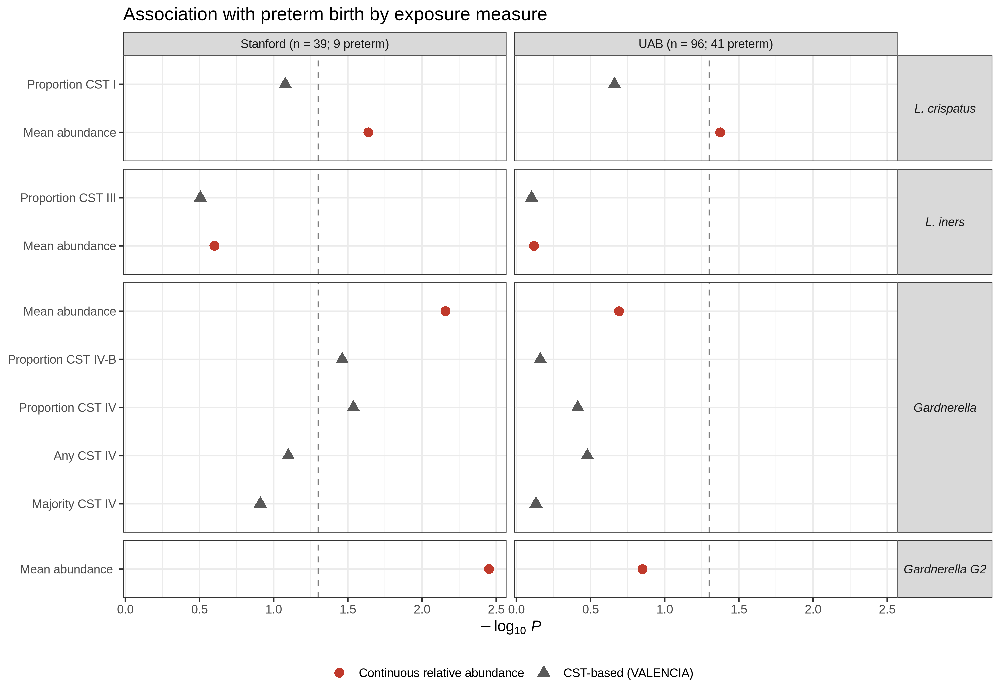

# Vaginal microbiome CSTs vs continuous taxon frequencies

Comparing a clustering/assignment algorithm (**VALENCIA community state types**) against a
**multi-variable quantitative frequency model** for detecting preterm-birth signal, using raw
16S rRNA reads from 2,179 vaginal swabs of 135 pregnant women.

## Findings

- CST labels explain 97% of *L. crispatus* variation but only 63% of *Gardnerella* (η², sub-CST).
- 93% of swabs where *L. iners* and *Gardnerella* coexist come from one cohort (UAB, predominantly African American); there the CST III/IV label is a threshold on a continuous score.
- Continuous frequencies detect 4 preterm-birth associations (p < 0.05), CST-based measures 2.
  The strongest, *Gardnerella* variant G2 (Stanford p = 0.0035), has no CST equivalent.



## Data

Raw reads: SRA [SRP115697](https://www.ncbi.nlm.nih.gov/sra/?term=SRP115697), from Callahan et al. 2017,
*PNAS* ([10.1073/pnas.1705899114](https://doi.org/10.1073/pnas.1705899114)).
Clinical metadata, sequencing-run labels, curated *Lactobacillus* reference sequences and the study's
variant table come from its [Stanford Digital Repository deposit](https://purl.stanford.edu/yb681vm1809)
(`data/external/`). The variant table was used to validate the pipeline: 2,639 of 2,699 variants
recovered (99.995% of reads), and the published association tests reproduced.

## Workflow

| Stage | What | Output |
|---|---|---|
| `01_pipeline/` | nf-core/ampliseq 2.18.0 on SLURM: DADA2 with per-run error models, SILVA 138 | `data/pipeline/` |
| `02_curation/` | *Lactobacillus* species by exact match to curated sequences | `02_curation/lacto_species_map.tsv` |
| `03_analysis/01–02` | Match variants to the deposit, build the 2,179 × 2,639 analysis table | `data/processed/` |
| `03_analysis/03–04` | Continuous-frequency PTB tests, community ecology | `03_analysis/results/` |
| `03_analysis/05–07` | VALENCIA CSTs and the CST vs continuous comparison | `03_analysis/results/07_*` |

```
01_pipeline/   assets/ bin/ conf/ params/ slurm/
02_curation/
03_analysis/   01_…R → 07_…R, functions.R, results/
data/          external/ pipeline/ processed/
docs/          decisions log, pipeline provenance, QC evidence
tools/VALENCIA/
```

## Run

```bash
# R >= 4.3: here, ggplot2, patchwork, vegan, epitools, phyloseq; Python 3: pandas, numpy
Rscript 03_analysis/01_match_variants.R
Rscript 03_analysis/02_build_analysis_table.R
Rscript 03_analysis/03_ptb_associations.R
Rscript 03_analysis/04_community_ecology.R
Rscript 03_analysis/05_valencia_input.R
python  03_analysis/06_run_valencia.py
Rscript 03_analysis/07_cst_vs_continuous.R
```

Wilcoxon tests use the pre-R 4.6 rule (exact only without ties), so results are identical across R versions.
The pipeline (`01_pipeline/slurm/`) needs the raw FASTQs (79.5 GB) and an HPC cluster.

## References

Callahan BJ et al. (2017) *PNAS* 114:9966–9971. France MT et al. (2020) VALENCIA. *Microbiome* 8:166.
